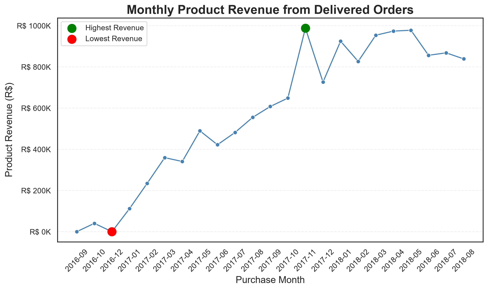
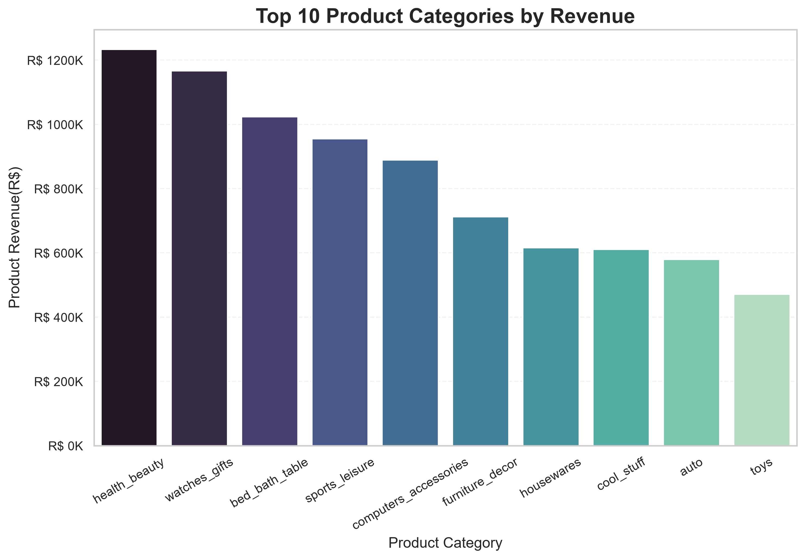
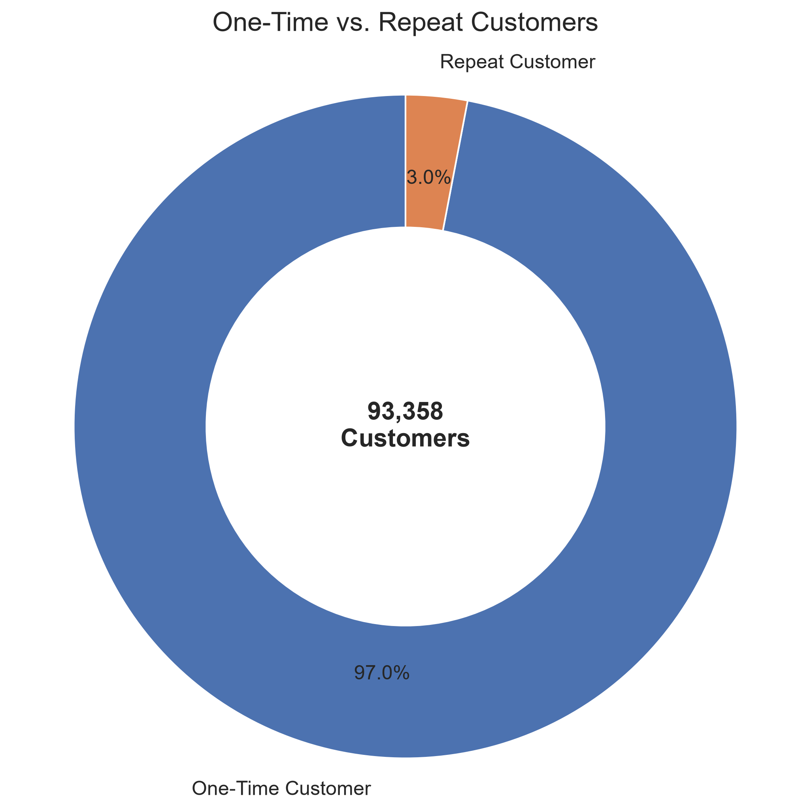
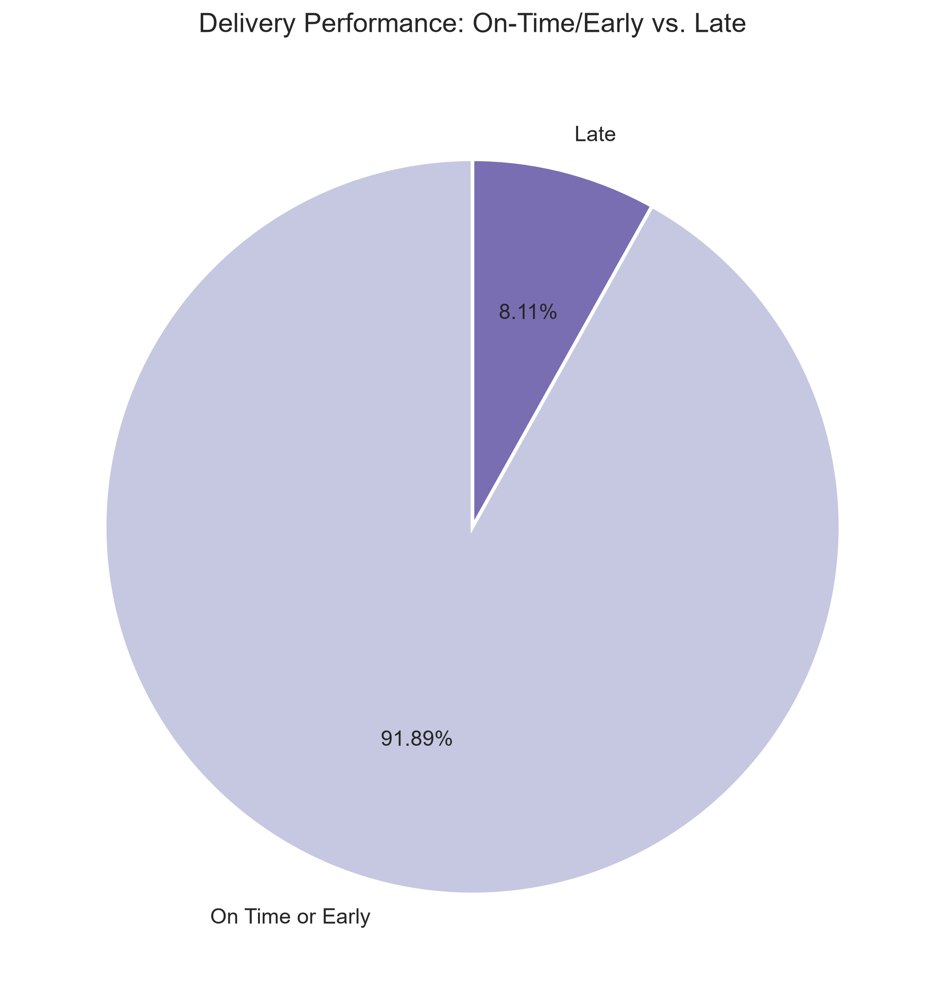
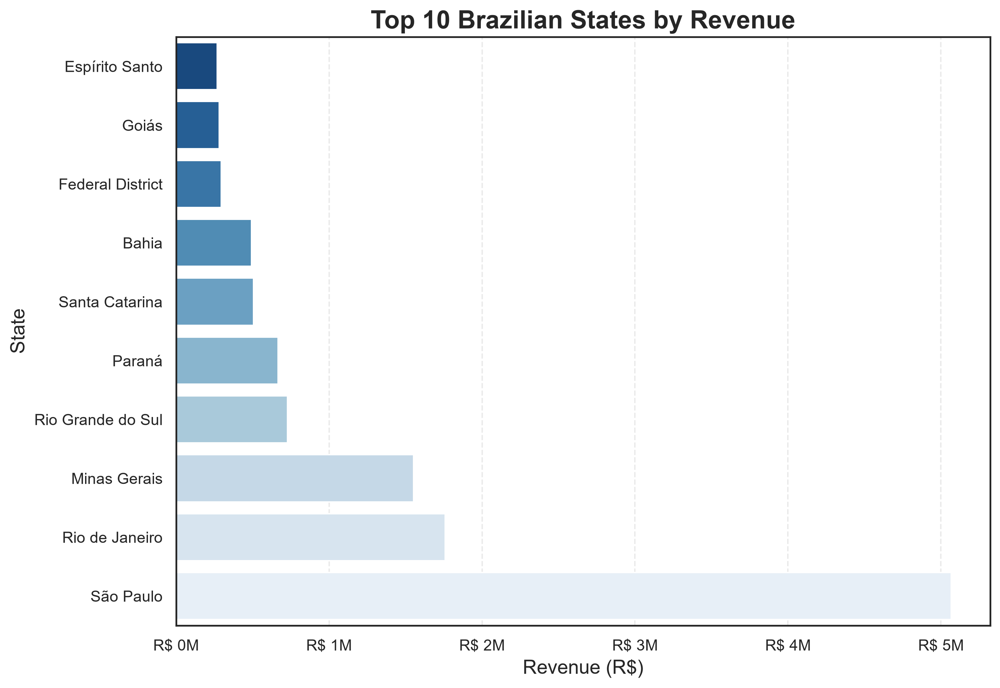
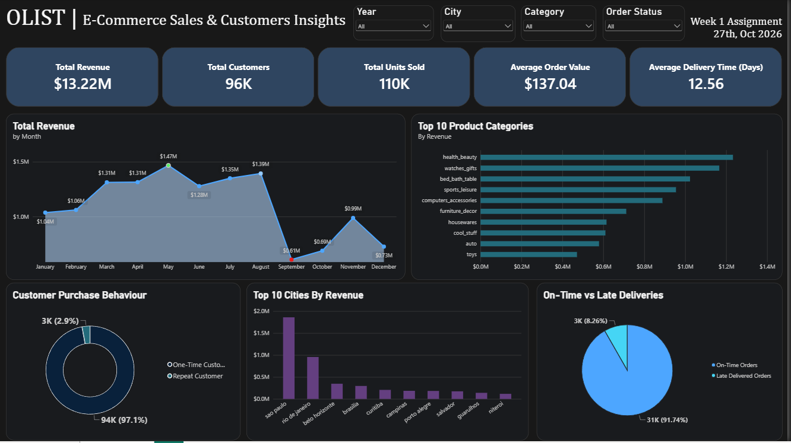

# Olist E-Commerce Data Analysis 

**Week 1 Internship Assignment | Data Analytics**

## 1. Project Overview

This project explores the Olist Brazilian e-commerce dataset to understand sales performance, customer purchasing behavior, product category performance, geographic revenue distribution, and delivery efficiency.

The project involves data preparation, exploratory data analysis (EDA), business KPI calculation, data visualization, and dashboard development using Microsoft Power BI.

The main objective is to transform raw e-commerce data into meaningful business insights that can help stakeholders understand sales trends, customer behavior, and operational performance.

## 2. Dataset Description

### About the Dataset

The Olist dataset contains information about orders placed through a Brazilian e-commerce marketplace. It includes multiple related datasets covering customers, orders, products, sellers, payments, reviews, and delivery information.

Because the information is distributed across multiple tables, the dataset can be analyzed from several perspectives, including sales, customer behavior, product performance, and logistics.

### Tables Used

The analysis uses nine cleaned CSV datasets.

| Dataset                      | Description                                                               | Analytical Purpose                       |
| ---------------------------- | ------------------------------------------------------------------------- | ---------------------------------------- |
| Orders                       | Order IDs, order status, purchase timestamps, approval and delivery dates | Order trends and delivery performance    |
| Order Items                  | Products purchased, sellers, prices, freight values                       | Revenue and units sold                   |
| Customers                    | Customer identifiers, city, state, and location                           | Customer analysis and geographic revenue |
| Products                     | Product IDs, categories, dimensions, and weight                           | Product and category performance         |
| Product Category Translation | Portuguese category names and English translations                        | Readable category labels                 |
| Order Payments              | Payment methods, installment counts, and payment values                   | Payment behavior                         |
| Order Reviews               | Review scores, comments, and timestamps                                   | Customer satisfaction analysis           |
| Sellers                      | Seller IDs and geographic information                                     | Seller distribution                      |
| Geolocation                  | Geographic coordinates associated with postal codes                       | Geographic analysis                      |

### Data Relationships

The datasets are connected through common identifiers, such as:

* `order_id` to connect orders with order items, payments, and reviews.
* `customer_id` to connect orders with customer information.
* `product_id` to connect order items with product information.
* `seller_id` to connect order items with seller information.
* Product category names to connect product data with translated category names.

These relationships make it possible to combine information from multiple tables and perform integrated analysis.

### Data Preparation and Cleaning

Before analysis, the datasets were reviewed and prepared to improve consistency and usability.

The preparation process included:

* Inspecting dataset dimensions, column names, and data types.
* Checking missing values and duplicate records.
* Converting date and timestamp columns into appropriate formats.
* Reviewing order statuses and delivery-related fields.
* Examining numeric fields used in revenue and order calculations.
* Preparing readable product category labels.
* Retaining missing values where they represented unavailable or inapplicable information rather than automatically deleting those records.

The geolocation dataset contained 261,831 exact duplicate rows out of 1,000,163 records, approximately 26.18%. Such duplicates require careful handling, particularly when performing geographic analysis.

Missing delivery timestamps may occur for orders that were not delivered, while review comments may be absent even when a review score exists. Therefore, missing values should be interpreted in context.

## 3. Business Questions

The analysis was designed to answer the following questions:

1. What is the total product revenue generated by delivered orders?
2. How many orders were successfully delivered?
3. What is the average order value?
4. How does revenue change over time?
5. Which product categories generate the most revenue?
6. What proportion of customers made repeat purchases during the observed period?
7. How efficiently are orders delivered compared with estimated delivery dates?
8. Which Brazilian states contribute the most revenue?

## 4. Data Analysis and Methodology

### Exploratory Data Analysis

Exploratory data analysis was used to understand the structure, quality, and distribution of the data before drawing conclusions.

The process included reviewing table dimensions, checking missing and duplicate values, examining order statuses, and inspecting important numerical and date fields.

### Sales Performance Analysis

Sales analysis focused on delivered orders to provide a consistent view of completed purchases.

The main metrics included:

* **Total Product Revenue:** Sum of product item prices for delivered orders.
* **Delivered Orders:** Number of distinct orders with delivered status.
* **Average Order Value (AOV):** Total product revenue divided by delivered orders.
* **Units Sold:** Number of order-item rows for delivered orders, treating each row as one purchased item.

Freight charges were excluded from the product revenue measure.

### Monthly Revenue Analysis

Revenue was grouped by purchase month to identify changes in sales activity over time.

A monthly trend chart was used to highlight stronger and weaker periods and identify months with the highest recorded revenue.

### Product Category Analysis

Product revenue was grouped by category to identify leading categories.

The analysis compared categories by revenue and, where available, units sold. This helps distinguish categories that generate high sales value from those that sell a larger quantity of items.

### Customer Purchasing Behavior

Customers were classified as one-time or repeat purchasers using the unique customer identifier and their delivered orders within the observed dataset period.

This analysis provides an indication of repeat purchasing activity during the available observation window. It should not be interpreted as a complete lifetime customer-retention measure.

### Delivery Performance Analysis

Delivery performance was evaluated by comparing actual delivery dates with estimated delivery dates.

The analysis included:

* Average time from purchase to delivery.
* Number of orders delivered on or before the estimated date.
* Number of orders delivered after the estimated date.
* Late-delivery rate among eligible delivered orders.

Orders without the required delivery timestamps were excluded from date-based delivery calculations.

### Geographic Revenue Analysis

Revenue was grouped by customer state to identify the major geographic contributors to product sales.

This analysis helps highlight the states that account for the largest portions of the observed revenue.

## 5. Key Findings

The following findings are based on the earlier analysis.

| Metric                                |                       Finding |
| ------------------------------------- | ----------------------------: |
| Product revenue from delivered orders | Approximately R$13.22 million |
| Delivered orders                      |                        96,478 |
| Average order value                   |        Approximately R$137.04 |
| Units sold                            |                       110,197 |
| Average actual delivery time          |      Approximately 12.56 days |
| Average estimated delivery time       |      Approximately 23.74 days |
| Late-delivery rate                    |           Approximately 8.11% |

### Sales and Product Categories

Health & Beauty, Watches & Gifts, and Bed/Bath/Table were among the highest-revenue product categories in the analysis.

Monthly revenue reached approximately R$987,765 in November 2017. April and May 2018 also recorded strong monthly revenue.

### Customer Purchasing Behavior

The analysis identified approximately 90,557 one-time customers and 2,801 repeat customers within the observed period.

This indicates that repeat purchasing represented a relatively small share of unique customers in the analyzed data.

### Delivery Performance

Among 96,470 delivered orders with valid delivery and estimated-delivery dates, approximately 91.89% arrived on or before the estimated date, while 8.11% arrived late.

This suggests that most eligible delivered orders met their estimated delivery dates, although late deliveries remain an area for operational improvement.

### Geographic Performance

São Paulo contributed approximately R$5.07 million in product revenue, followed by Rio de Janeiro at approximately R$1.76 million and Minas Gerais at approximately R$1.55 million.

Together, these three states accounted for approximately 63.38% of the analyzed product revenue.

## 📊 Charts and Visualizations

This project includes visualizations to highlight key patterns in the Olist e-commerce dataset. The charts help explain sales performance, product category contribution, customer purchasing behavior, and delivery trends.

### 1. Monthly Revenue Trend

Shows how revenue changes over time and helps identify months with higher sales.

### 2. Top Product Categories by Revenue

Compares product categories based on revenue to identify the categories contributing the most to sales.

### 3. Customer Purchase Behavior

Illustrates the distribution of one-time and repeat customers within the observed dataset period.

### 4. Delivery Performance

Compares on-time or early deliveries with late deliveries to highlight delivery reliability.

### 5. Revenue by State

Highlights the states contributing the most revenue and shows the geographic concentration of sales.

## 6. Power BI Dashboard

A one-page dashboard was developed in Microsoft Power BI to present the main metrics and findings in a clear, interactive format.

### Dashboard Components

* KPI cards for product revenue, delivered orders, average order value, and units sold.
* Monthly revenue trend chart.
* Top product categories by revenue.
* Customer purchasing behavior visualization.
* Delivery performance visualization.
* Revenue by customer state.
* Filters for relevant dimensions, where supported by the data model and measures.

### Dashboard Preview

### Dashboard File

The Power BI report is available at:

`03_outputs/dashboard/olist_ecommerce_dashboard.pbix`

Download the file and open it in Microsoft Power BI Desktop to explore the report.

## 7. Tools and Technologies

* **Python:** Data cleaning and exploratory analysis.
* **Pandas:** Data manipulation and preparation.
* **Microsoft Power BI:** KPI development and interactive visualization.
* **Jupyter Notebook:** Documenting and executing analysis.
* **GitHub:** Version control and project documentation.

## 8. Limitations

* Product revenue is calculated from item prices and excludes freight charges.
* Profit cannot be calculated reliably because cost data is not available.
* Repeat-purchase behavior is measured within the observed dataset period.
* Missing delivery timestamps limit the number of records available for delivery analysis.
* Partial monthly coverage may affect comparisons across time.
* The analysis describes patterns in the available data and does not establish causal relationships.

## 9. Conclusion

This project demonstrates how related e-commerce datasets can be cleaned, analyzed, and visualized to generate useful business insights.

The analysis highlights sales performance, leading product categories, customer purchasing behavior, geographic revenue concentration, and delivery outcomes.

The Power BI dashboard consolidates these findings into a single report, making it easier to review important metrics and explore business performance.

## 10. Future Improvements

Potential extensions include:

* Analyzing payment methods and installment behavior.
* Examining review scores and customer satisfaction.
* Investigating relationships between delivery delays and review scores.
* Developing more detailed customer-retention metrics.
* Improving geographic analysis using validated location data.
* Adding additional dashboard pages for payments, reviews, and sellers.

## Author

**Mahi Choudhary**

* GitHub: mahic1289-lgtm
* Project: Olist E-Commerce Data Analysis Dashboard
